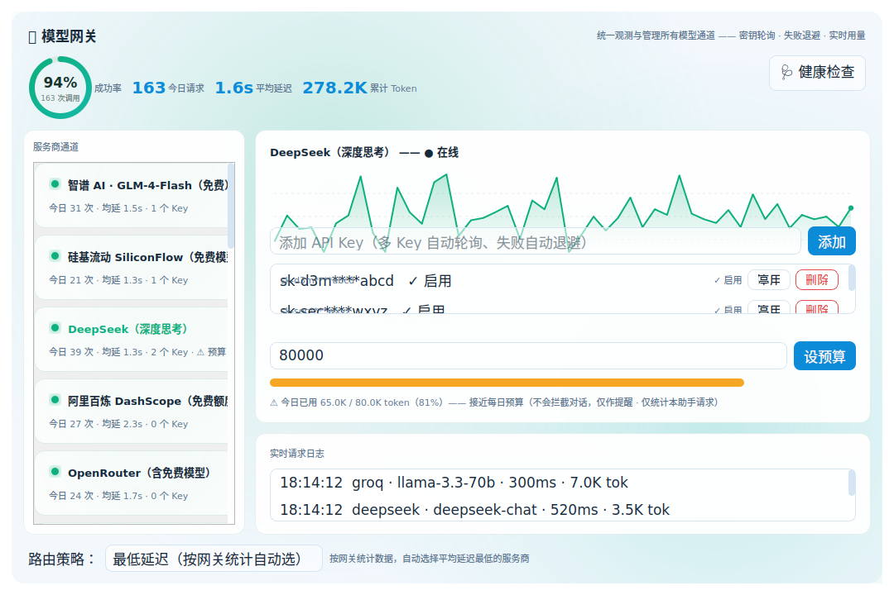
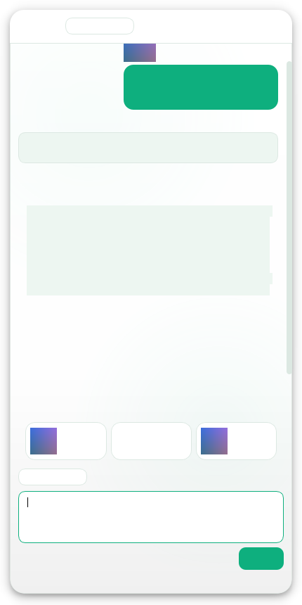
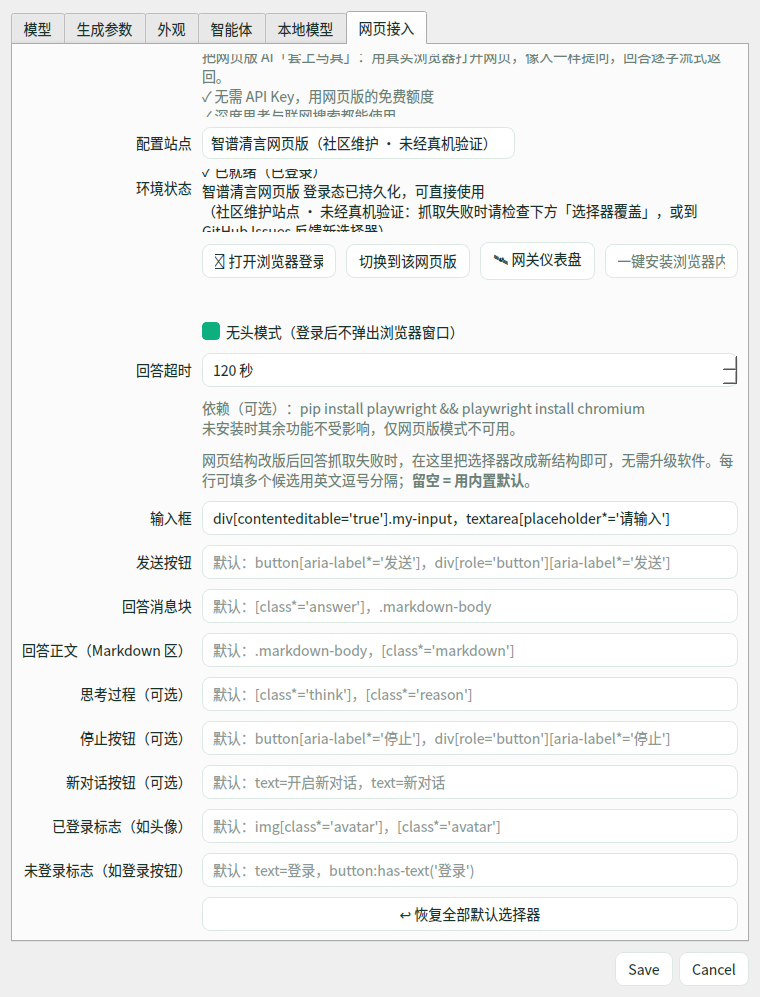
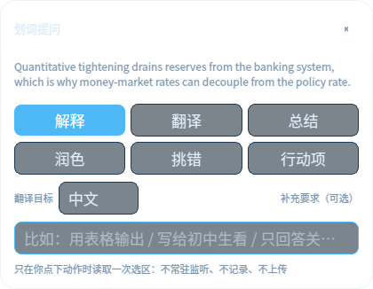
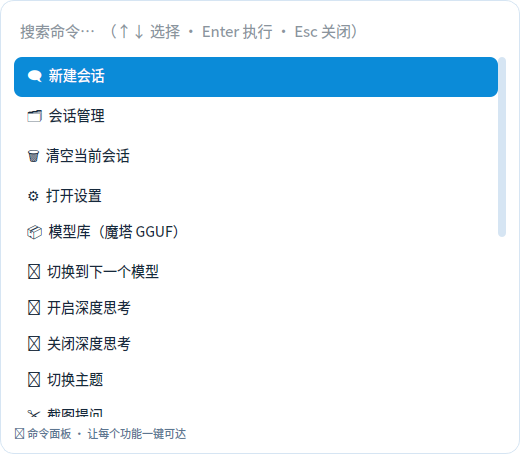
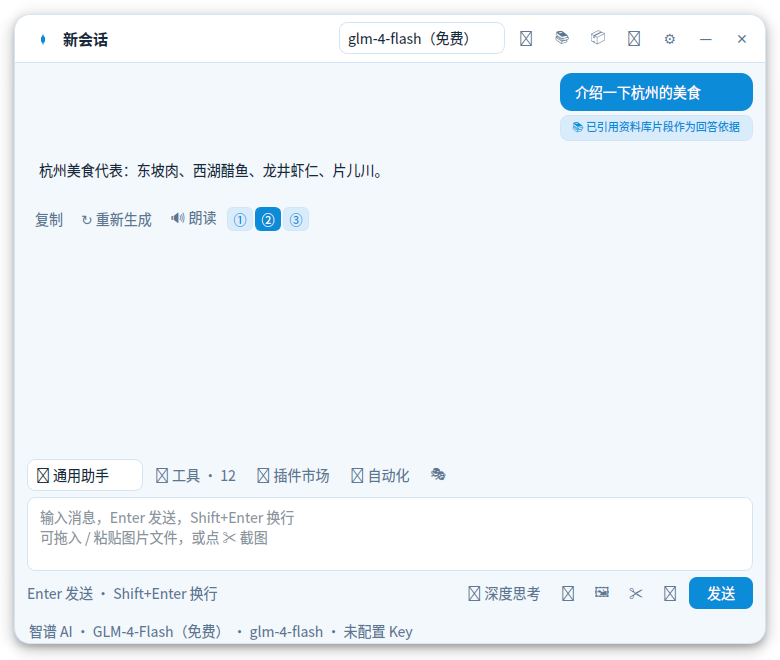
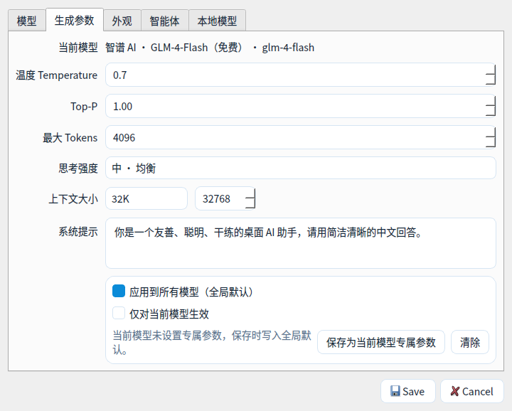
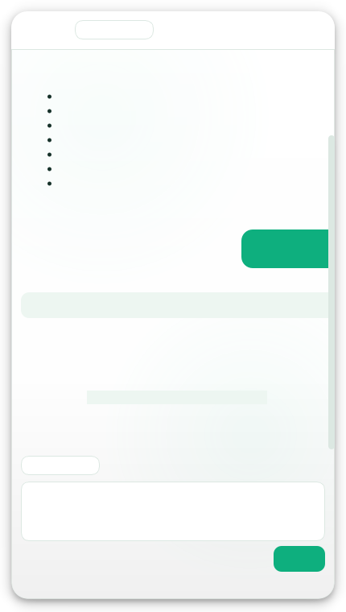
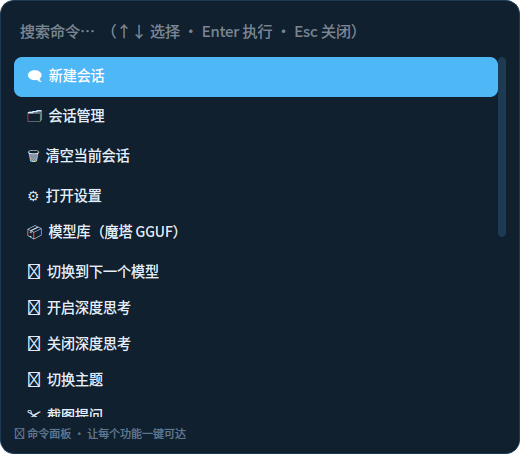
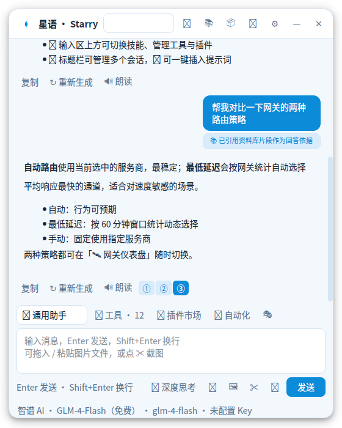

# 星语 · Starry

> **当前版本：v13.8.0** · 跨平台本地优先 AI 助手（PyQt5 桌面 / Toga 安卓 / CLI / Windows CLI+GUI EXE / Linux deb）
> 本页下半部分是 v7 → v13.5 的完整历史编年史；**首屏为当前版本导航**。

## ⚡ 当前版本速览（v13.8.0）

| 想做什么 | 去哪里 |
| --- | --- |
| **直接双击运行（新版根目录产物）** | 根目录 `星语Starry-GUI-v13.8.0.exe`（+ `.sha256`）；历代 EXE 在 `releases/` |
| **模型改不了 / 默认 LM Studio** | 设置 → 模型：空模型引导 + 错配一键修正；CLI `starry --model-diagnose` |
| **发图片报 HTTP 400 / 让助手看图** | 带图自动切视觉模型；本机无视觉模型时本地忽略图片并提示，不再 400 |
| **界面拥挤 / 上下栏太紧** | 设置 → 外观 → **栏目密度**（紧凑/标准/宽松/超宽松，即时生效）；`Ctrl+Alt+D` 循环切换；`↺ 恢复推荐布局` 一键放大；CLI `starry --ui-layout` 诊断 |

| **清空对话 / 删除单条消息** | 命令面板 `🗑 清空当前会话`（只清当前对话，其它对话不变）；`☑ 选择并删除消息` 勾选后点「删除选中」 |
| **主窗口背景自定义 / 拖拽** | 设置 → 外观 → 🖼 主窗口背景（纯色/图片/强度，立即应用）；标题栏与空白区均可拖动 |
| **缓存清理 / 子窗口卡住** | 缓存清理已全异步、按钮全程可点；所有子窗口非模态，与主窗口可同时操作 |
| **看日志 / 排障** | Ctrl+K → `🛠 开发者调试面板`；CLI `--devlog` / `--debug` |
| **让界面自动适配屏幕** | 设置 → 外观 → 「立即按屏幕适配」；或开启「启动时自动按屏幕适配」 |
| **清理缓存** | 设置 → 「💾 存储与缓存」；Ctrl+K → `🧹 清理应用缓存` |
| **不会申请 API Key** | Ctrl+K → `🔑 申请 API Key 指引`；设置页「📖 申请步骤」 |
| **清理应用缓存** | Ctrl+K → `🧹 清理应用缓存`（先备份、可撤销，不碰用户数据） |
| **完善大模型能力** | Ctrl+K → `🧠 智能选模型` / `📊 模型能力矩阵` / `🧭 开关智能模型路由` |
| 下载可直接运行的产物 | [Releases 索引](RELEASES.md) → `releases/星语Starry-v13.2.0/` |
| 看本版改了什么 | [发布说明](RELEASE_NOTES.md) / [CHANGELOG](CHANGELOG.md) |
| **全局搜索 / 引用 / 工具省 token** | Ctrl+K → `🔎 全局搜索`、`📎 本轮引用来源`；详见 [CHANGELOG §13.3.0](CHANGELOG.md) |
| **每次更新重打包后代版本 EXE** | `python scripts/build_root_exe.py` → 自动按 `APP_VERSION` 生成根目录 EXE |
| **兼容范围 / 配置项 / 异常边界** | [Hub 兼容契约](docs/HUB兼容范围与配置_v13_2.md) |
| **401 排查 / 企业部署** | [企业级运维与故障排查](docs/企业级运维与故障排查_v13_2.md) |
| **提交到 GitHub / 发布 Release** | [GitHub 提交与 Release 发布流程](docs/GitHub_提交与Release发布流程.md)；一键脚本 `scripts/git_push.sh` / `scripts/github_release.sh` |
| **多平台 Release 资产** | [v13.8.0 Release](https://github.com/SYSTEM-SEWWO/Starry/releases/tag/v13.8.0)：Windows GUI EXE / Debian `.deb` / macOS / Linux / Android-Termux 包 + `SHA256SUMS-13.8.0.txt` |

| **删除/编辑/查找单条消息** | 输入框旁常驻 `☑`（勾选批量删）与 `🔍`（Ctrl+F 查找）；右键单条消息可复制/编辑/收藏/删除；`/help` 查看斜杠命令 |
| **所有二级窗口毛玻璃圆角** | v13.8 起设置、会话、缓存、关于等所有子窗口自动套圆角磨砂玻璃 + 投影，与主窗口一致 |
| **会话备份 / 恢复** | 命令面板 `💾 备份全部会话` / `♻️ 恢复会话备份`，快照保留最近 10 份 |

> **资产名说明**：GitHub 会剥离资产名中的非 ASCII 前缀，所以 Release 上显示
> `Starry-*`；仓库 `releases/` 目录内为带「星语」前缀的同一文件，内容完全一致。
> macOS / Linux / Android 包是**真实可运行的源码分发包**（含完整源码与一键启动
> 脚本）；原生 `.app`/`.dmg`、ELF、APK 需在对应系统执行
> `scripts/build_macos.sh` / `build_linux.sh` / `build_android.sh apk` 构建。
> 本地一键生成：`python scripts/build_release_assets.py`。

## 🚀 如何使用（v13.8.0）

### 1) 直接运行（Windows，最省事）

双击根目录 **`星语Starry-GUI-v13.8.0.exe`**。首次启动会解压 10–30 秒属正常。
**状态栏右下角会显示 `v13.8.0 · 布局宽松`** —— 用它确认你跑的是新版；若显示旧版本号，说明打开的是旧 EXE（历代文件都在 `releases/` 子目录）。

> 默认服务商 `lmstudio`（本地优先，无需 API Key）。若 LM Studio 未启动，点右上角 ⚙ 检查 Base URL / 模型。

### 2) 布局太挤怎么办（本轮重点）

旧版 `config.json` 里保存了 `430×640` 的窗口尺寸，会**覆盖**代码里的新布局，所以「改了却看不到变化」。v13.8.0 首次启动会**自动一次性迁移**到 `620×860`，之后你手动拖的尺寸不再被覆盖。

| 方式 | 操作 |
| --- | --- |
| 设置页 | ⚙ → 🎨 外观 → **栏目密度**：紧凑 / 标准 / **宽松(默认)** / 超宽松；保存即时生效 |
| 一键放大 | 同页 **↺ 恢复推荐布局（放大窗口）**，重置尺寸与位置 |
| 快捷键 | `Ctrl+Alt+D` 循环切换四档 |
| 命令面板 | `Ctrl+K` → `📐 切换栏目密度` / `↺ 恢复推荐布局` |
| 托盘菜单 | 右键悬浮球 → `📐 切换栏目密度` |
| 命令行 | `starry --ui-layout` 查看全部尺寸；`starry --ui-density 超宽松` 直接设置 |

四档差异（窗口 / 标题栏 / 输入框 / 发送按钮）：

| 档位 | 窗口 | 标题栏 | 输入框 | 发送 |
| --- | --- | --- | --- | --- |
| 紧凑 | 480×680 | 48 | 74 | 32 |
| 标准 | 540×760 | 54 | 88 | 36 |
| **宽松（默认）** | **620×860** | **64** | **112** | **46** |
| 超宽松 | 720×960 | 72 | 132 | 52 |

标题栏的 6 个次要图标（会话 / 资料库 / 记忆 / 模型库 / 产物 / 命令面板）已收进 **「⋯ 更多」菜单**，横向不再挤成一团；功能一个不少。

### 3) 提交到 GitHub（详细流程见专门文档）

```bash
# 首次（把 <用户名>/<仓库名> 换成你自己的）
git remote add origin https://github.com/<用户名>/<仓库名>.git
git push -u origin main

# 日常一键提交 + 推送
bash scripts/git_push.sh "feat(ui): 栏目密度四档与即时切换"
```

### 4) 发布 Release

```bash
# 方式 A：打 tag，CI 自动校验 / 打包 EXE / 建 Release（推荐）
V=13.6.5
git tag -a "v$V" -m "v$V"
git push origin "v$V"
gh run watch

# 方式 B：本地一键打包 + 校验 + 建 Release（需 gh auth login）
bash scripts/github_release.sh 13.6.5
```

完整步骤、参数、排错表见 **[docs/GitHub_提交与Release发布流程.md](docs/GitHub_提交与Release发布流程.md)**。

### 5) 源码运行（中文路径注意）

```bash
python main.py
```

若项目放在含中文的目录，v13.8.0 起 `main.py` 会自动把 Qt 平台插件复制到纯英文临时路径，避免 `no Qt platform plugin could be initialized` 弹窗；直接双击 EXE 则完全不受影响。

| **真实 GUI 测评证据** | [真实 GUI 测评报告](docs/真实GUI测评报告_v13_2.md)（`docs/evidence_v13_2/`） |
| GUI 桌面版 EXE | [Windows GUI EXE 指南](docs/使用指南_Windows_GUI_EXE_v13_1.md) |
| Skills Hub / 技能更新 | [使用指南 v13.1](docs/使用指南_v13_1.md) |
| 电脑端 CLI / deb | [Windows CLI EXE 指南](docs/使用指南_Windows_EXE_v13_0.md) · [Linux deb 指南](docs/使用指南_Linux_DEB_v13_1.md) |
| 整体项目 / 多线并行 / 自动更新 | [使用指南 v13](docs/使用指南_v13_0.md) |
| 二次开发 / 开放接口 | [API 开放文档 v13.1](docs/API开放文档_v13_1.md) + 本文 Hub 契约 |
| 资产与成本清单（APK 单列） | [交付资产与财务清单](docs/交付资产与财务清单_v13_2.md) |

**本版主线**：**GUI 版 EXE 与 CLI EXE 双产物共存** + **Skills Hub 新增 DeepSeek 提示词模板**
（GitHub / DeepSeek / Claude Code / WorkBuddy 统一模型）+ **真实 GUI 测评驱动的 401 企业级治理**。

> 新增能力全部零网络、零第三方依赖，默认离线确定性执行：
> **不需要 API Key、不需要联网**，401 时 Skills Hub / 工作台等离线能力照常可用。
> v13.1 / v13.0 / v12.0 的全部能力保留。

### 快速开始

```bash
# 桌面 GUI（Ctrl+K → Skills Hub / API 诊断 / 整体项目工作台）
python main.py

# ★ v13.2 Skills Hub（含 DeepSeek 提示词模板，离线、零依赖）
python starry_cli.py --hub                                   # 列出全部技能
python starry_cli.py --hub-sources deepseek --hub            # 只看 DeepSeek
python starry_cli.py --hub-config config.hub.example.json --hub
python starry_cli.py --hub-config-show                       # 看生效配置
python starry_cli.py --hub-diagnostics                       # 看扫描异常边界
python starry_cli.py --hub-info deepseek-code-review         # 看提示词正文
python starry_cli.py --hub-update --hub-manifest hub.json    # 技能更新判定
python starry_cli.py --hub-import release-checklist          # 导入技能库

# ★ GUI EXE 无显示器自检（结果写入文件，不依赖 stdout）
dist\星语Starry.exe --version --out version.txt
dist\星语Starry.exe --selftest --out selftest.json
python scripts/smoke_gui_exe.py --exe dist/星语Starry.exe --expect-version 13.2.0
python scripts/smoke_cli_exe.py --exe dist/星语Starry-CLI.exe --expect-version 13.2.0

# ★ 401 排查：Ctrl+K → 「API 诊断」；或企业部署显式隔离配置目录
set STARRY_DATA_DIR=D:\StarryProfiles\user01 && dist\星语Starry.exe

# 整体项目 → 分波并行 → 报告（v13.0 保留）
python starry_cli.py --project "调研并撰写发版方案" --parallel --workers 4
python starry_cli.py --workbench
python starry_cli.py --update-check --update-manifest update.json

# v12 能力保留
python starry_cli.py --doctor
python starry_cli.py --budget 4096
python starry_cli.py --archive 备份.starry

# Windows CLI EXE / Linux deb
dist\星语Starry-CLI.exe --hub
sudo dpkg -i dist/星语Starry-CLI-v13.2.0.deb && starry --hub
```

### 发版规则（像 GitHub Releases 一样）

一个 tag `vX.Y.Z` → CI 跑版本门禁与全量自测 → 产出
`releases/星语Starry-vX.Y.Z/`（**全部源码 + 主文件 + 全部 docs/*.md + 构建脚本 + 资产**）
+ 同名 zip + `checksums.txt` + `MANIFEST.md` + `SHA256SUMS-vX.Y.Z.txt`，历史版本只追加不覆盖。
索引见 [RELEASES.md](RELEASES.md)。生成器：`python scripts/make_release.py --version X.Y.Z`。
Release 资产齐备后，`update-manifest.yml` 自动回传权威 `update.json`。

### 回归总览

`selftest.py 779/0` · `test_v12_features 63/63` · `test_v13_features 172/172` ·
`test_v13_1_hub 131/131` · `test_v13_2_hub 73/73` · `test_enterprise_api 80/80` ·
`test_android_v12 37/37` · `test_app_logic 16/16`
→ **合计 1351 项通过，0 失败**。

GUI EXE offscreen 自检 **31/31** · 两份 EXE 真实子进程冒烟通过 ·
47 文件三端同源 · 5 个 workflow YAML 全部解析通过 · 发布快照终验见本版交付。

`python scripts/verify_release.py --version 13.2.0` 可随时复跑终验：
zip CRC、zip 与目录逐文件哈希、SHA256SUMS、敏感文件、版本索引、
以及「RELEASE_NOTES.md 不是占位文本」。

---

## 历史编年史（v7 → v11.5，原文保留）


一个用 **Python + PyQt5** 编写的本地桌面 AI 伙伴：豆包风格的**悬浮小球**，单击展开聊天窗口；支持 **21 家服务商**（多家免费 API）、**四种本地模型**（Ollama / LM Studio / **阿里魔塔 GGUF 一键下载**）与 **网页版浏览器接入（DeepSeek / 智谱清言 / 豆包，无需 API Key）**，可随时**切换模型**；推理模型的**思考过程实时呈现**（可折叠），配有**思考动画**；回答以 **Markdown 渲染为正常富文本**，流式输出；支持**文件 / 图片 / 区域截图**多模态提问。

v7 五大升级：**🌐 多站点网页接入**（马具工厂注册表：DeepSeek / 智谱清言 / 豆包三站，独立 profile 与选择器）、**🎛️ 选择器覆盖编辑器**（站点改版后在设置页产品内修复，不再手改 config.json）、**🛰 每日 Token 预算告警**（网关按 24h 窗口统计，80% 预警 / 100% 超支红条，旁路设计绝不拦截对话）、**🩺 并行健康检查**（19 家最坏 76s → 约 12s，进度实时可见）、**🧪 536 项自测**（含 12 项浏览器端到端真实验证 + 三平台 CI）。

v7.1 再进一步：**✨ 动效细节全面增强**（液态玻璃光泽扫过 / 悬浮球待机极光弧 / 输出态均衡器峰值帽 / 圆环流星尾 / 背景微光粒子 / 折线末端脉冲 / 开屏星尘迸发）与**📦 生产链打包**（GitHub Actions 新增 Windows 单文件 exe 打包 job：一键脚本复用 + 启动冒烟 + 产物上传），自测 **558 项**。

v7.2 对标开源生态（调研见 [`docs/竞品调研_v7_2.md`](docs/竞品调研_v7_2.md)）：**✂️ 划词提问**（任意应用选中文字 → `Ctrl+Shift+Q` → 解释/翻译/总结/润色/挑错/行动项）、**🚶 桌面拟人化**（闲置漫游 + 随机提示气泡，像伙伴而不是工具）、**🪶 更轻**（排除 15 个未用 Qt 模块、存储层去重、新功能全部小模块化），自测 **600 项**。

v7.3 以 **GitHub 开发者视角复审 v7.2**（见 [`docs/代码评审_v7_3.md`](docs/代码评审_v7_3.md)）后落地：**🪟 真·毛玻璃**（桌面快照背景实时虚化 + 主题色染色 + 顶部高光 + 1px 亮边 + 环境光晕，`ui/frost.py`，聊天窗 / 划词窗 / 关于页 / EULA 全量替换伪玻璃）、**🔵 圆角加大到 10/14/20px**（更柔的现代玻璃感）、**🎬 资深级开屏动效**（多层视差星尘 + 极光弥散 + ✦ bloom 光晕 + 逐字 kinetic 标题流光 + 底部微光进度条）、**🏢 企业商用合规**（首启 EULA 许可门 + 商业 LICENSE + 关于页商业授权卡 + 许可密钥字段），自测 **618 项**。

v7.4 先做 **GitHub 开源检索**（见 [`docs/GitHub开源调研_v7_4.md`](docs/GitHub开源调研_v7_4.md)）再决定补什么：**🔌 MCP 工具生态**（纯标准库实现 stdio JSON-RPC 客户端，任意第三方 MCP 服务器的工具直接进智能体工具箱，`core/mcp.py`，零新依赖）、**👁 一键看屏幕问答**（一键抓全屏 + 预设问题，就屏幕内容直接提问，`core/screen.py`），自测 **645 项**。

v7.5 按「**代码安全性评估 → HR复审 → 美术复审 → 资深程序员复审 → GitHub复审 → 反复优化**」工作流推进（见 `docs/代码安全性评估_v7_5.md` 等五份文档）：**🛡 代码安全性落地**——EULA 防篡改令牌（直编 config 无法绕过）、许可密钥离线校验（伪造串被拒）、`config.json` 落盘权限收敛为 `0o600`；**🔒 MCP 危险工具动作护栏**（写/执行类工具来自非信任服务器默认拒绝，设置页可标记「信任」）；**🪟 毛玻璃厚度增强**（底部内阴影，更显浮起）；自测 **666 项**。

v7.6 在最前端加「**整体项目 + 打包成 exe + 代码结构方便提交**」：补齐 `CONTRIBUTING.md` / `CODE_OF_CONDUCT.md` / `docs/项目结构与提交指南_v7_6.md`，并将 `starrystar.spec` 经 PyInstaller **真实构建验证**（Linux 产出 134MB 单文件，入口 / 隐藏导入 / PyQt5 收集全通过，同一 spec 在 Windows 即产出 `星语Starry.exe`），新增 `docs/API开放文档_v7_6.md`（MCP 接入 / `register_tool` 扩展 / 自动化 / 网关 / 配置 / 打包六类对外接口）。随后续走「代码安全性评估 → HR复审 → 美术复审 → 资深程序员复审 → GitHub复审 → 反复优化 → 创造力复审」并产出对应文档，`.gitignore` 加固（`.env` / `*.key` 等）。

**v8.0 大版本更新（深度思考多一点）**：新增 **🧠 长期记忆系统**（`core/memory.py`）——跨会话记住用户画像 / 偏好 / 项目背景，对话中启发式学习、按相关性注入系统提示，配 `ui/memory_dialog.py` 可视化查看 / 删除 / 清空 / 开关，写入前经**提示注入护栏**（拒 HTML / 指令诱导）+ `memory.json` 落盘 `0o600`；新增 **🧩 深度思考引擎**（`core/reasoning.py`）——统一解析推理模型的 `<think>` 思考过程并流式剥离进可折叠思考块，让「想」被看见。该轮工作流在 v7.6 基础上**最前端再加整体项目 + 打包 + 提交结构**，并落实「**每版独立版本化文件夹**」分发约定（`星语Starry-v8.0/` 等）。自测 **693 → 727 项**（+34 项记忆 / 推理用例全绿）。对应文档：`docs/项目结构与提交指南_v8_0.md`、`代码安全性评估_v8_0.md`、`HR复审_v8_0.md`、`美术复审_v8_0.md`、`资深程序员评审响应_v8_0.md`、`GitHub复审_v8_0.md`、`创造力复审评价_v8_0.md`、`API开放文档_v8_0.md`。

**v9.0 大版本更新（深度思考更好看 + 复刻 REA + 学热门创新）**：本轮在最前端新增「下载 WorkBuddy Linux 版 → 用 GitHub 爆火项目 REA 复刻逆向能力 → 检索热门项目学创新」外部学习工作流（调研见 `docs/创新功能调研_v9_0.md`）。具体落地：**深度思考可视化升级**——悬浮球 THINKING 态加入「液态玻璃折射 + 微光扫掠」覆盖层（`ui/floating_ball.py`），并在球上方以「液态玻璃字幕卡 + 微光」实时呈现思考片段（让「想」被看见，且可缩小成悬浮球形态）；**REA 逆向工程集成**（`core/rea.py`）——把 GitHub 爆火项目 REA（Reverse Engineer Anything，MIT，MCP 服务器封装 Ghidra/IDA 等逆向工具）以既有 MCP 生态一键接入，提供预设 / 证据驱动工作流 / 命令面板入口；**产物预览 Artifacts**——聊天窗 🧪 按钮 + 命令面板，提取最近回复的 ```html 块在浏览器预览（对齐 Cherry Studio / LobeChat / Open WebUI）。自测 727 → 751 项（+24 项全绿）。对应文档：`docs/创新功能调研_v9_0.md`、`代码安全性评估_v9_0.md`、`HR复审_v9_0.md`、`美术复审_v9_0.md`、`资深程序员评审响应_v9_0.md`、`GitHub复审_v9_0.md`、`创造力复审评价_v9_0.md`、`API开放文档_v9_0.md`、`项目结构与提交指南_v9_0.md`。

**v10.0 大版本更新（平台分发 + 无界面命令行）**：本轮在 v9.0 工作流最前端新增「整体项目 + 打包 + 提交结构」后，进一步落实「**一处代码、多端分发**」——新增 **🌐 平台检测与适配**（`core/platforms.py`：自动识别 Windows / Linux / 统信 UOS / Android(Termux) / macOS）与 **⌨ 无界面命令行版**（`core/cli.py` + `starry_cli.py`，**零 PyQt 依赖**，复用与桌面版完全相同的 `ChatClient` 与 `AgentRuntime` 智能体运行时，支持 `--agent` 工具调用、`--json` 结构化输出、`--platform` 诊断、长期记忆注入、REA 预设并入）。配套 **📦 各平台版本后缀分发**：`星语Starry-v10.0-windows-cli` / `linux-cli` / `uos`（.deb）/ `android`（Termux+APK 命令）以及桌面 GUI 全量包，每个文件夹均含**完整工程**（源码 + 全部 `docs/*.md` + 主文件 + README/CHANGELOG），自包含可独立构建。打包脚本 `scripts/build_*_cli.*` / `build_uos.sh` / `build_android.sh` 与双 PyInstaller 配置（`starrystar.spec` GUI / `starry_cli.spec` console）齐备。自测 751 → **779 项**（+28 项平台检测 / CLI 引擎用例全绿）；PyInstaller 真实构建验证（桌面版 + 命令行版均通过）。对应文档：`docs/平台适配与命令行集成说明_v10_0.md`、`命令行使用指南.md`、`使用指南_Windows_CLI.md`、`使用指南_Linux_CLI.md`、`使用指南_UOS.md`、`使用指南_Android_APK.md`、`代码安全性评估_v10_0.md`、`HR复审_v10_0.md`、`美术复审_v10_0.md`、`资深程序员评审响应_v10_0.md`、`GitHub复审_v10_0.md`、`创造力复审评价_v10_0.md`、`API开放文档_v10_0.md`、`项目结构与提交指南_v10_0.md`。

**v11.0 大版本更新（安卓 APK 开箱即用 + UOS deb + GitHub Releases 式分发）**：本轮延续「整体项目 + exe/各端打包 + 提交结构 → 代码安全性评估 → HR复审 → 美术复审 → 资深程序员复审 → GitHub复审 → 反复优化 → 创造力复审 → API开放文档」全链路，并把重心放到**移动端与信创端的开箱即用**——新增 **📱 安卓 APK（BeeWare / Toga 原生封装）**：基于 `briefcase → Gradle → python-for-android`，**移植全部核心代码**（聊天 / 深度思考流 / 长期记忆 / 智能体工具 / 平台检测全部复用桌面版纯 Python `core/`，非另写伪实现），以「思考卡片 + 实时流式文字」在移动端还原桌面「液态玻璃悬浮球」，后台线程联网 + 事件循环线程安全回写（规避安卓主线程网络限制）；新增 **🐧 UOS / Debian `.deb` 完整打包并验证**（`星语Starry-CLI-UOS.deb`，32MB，已 `dpkg-deb -I` 校验）；新增 **🚀 GitHub Releases 式发版**（`.github/workflows/build-android.yml`：推送 `v*` tag 即在 GitHub 运行器**真实编译并签名 APK、自动发布到 Releases**，侧载即装）；版本号四处一致 **11.0.0**；V8.0 / V9.0 / V10.0 能力完整保留。对应文档：`docs/使用指南_Android_APK.md`、`代码安全性评估_v11_0.md`、`HR复审_v11_0.md`、`美术复审_v11_0.md`、`资深程序员复审_v11_0.md`、`GitHub复审_v11_0.md`、`创造力复审_v11_0.md`、`API开放文档_v11_0.md`。

**v11.1 功能更新（持续迭代、增加功能）**：在 v11.0 基础上新增 **🔍 跨会话相关性检索**（`core.sessions.SessionStore.search_ranked`：中英文混合分词 + 词频/标题加权排序 + 高亮摘要，桌面会话框直接看命中片段）与 **📤 多格式导出**（`core.exporter` 新增 JSON / TXT / HTML，导出对话框四选一）。两项均为纯逻辑、桌面与安卓共用 `core/`；新增 `test_search_export.py`（5/5），安卓逻辑回归 `test_app_logic.py` 14/14 全绿；版本号四处一致 **11.1.0**。详见 `docs/RELEASE_NOTES_v11_1.md` 与 `docs/评审纪要_v11_1.md`。

**v11.2 功能更新（持续优化、增加更新功能）**：延续「整体项目 + 不断优化」迭代，新增 **🏷 会话标签**（`SessionStore.set_tags` / `list_tags`，会话框可按标签筛选、每行 🏷 编辑，桌面与安卓共用 `core/`，每条会话摘要与检索结果携带 `tags`）、**✏ 消息编辑/删除**（`edit_message` / `delete_message`，系统提示受保护、越界安全返回；桌面新增「🗑 删除最后一条消息」命令面板 + 托盘入口）与 **📄 PDF 导出**（`conversation_to_pdf` 复用 HTML 版式经 WeasyPrint 渲染，导出对话框新增 PDF 选项、环境缺失自动隐藏）。新增 `test_v11_2.py`（21/21），安卓逻辑回归 `test_app_logic.py` 14/14 全绿；版本号四处一致 **11.2.0**。详见 `docs/RELEASE_NOTES_v11_2.md` 与 `docs/评审纪要_v11_2.md`。

**v11.3 功能更新（安卓彻底修复闪退 + 电脑端新增功能）**：本轮聚焦「**安卓端还是闪退 → 彻底根因修复 + 优化流程**」与「**电脑端增加更多新功能**」两条主线。**安卓闪退根治**：① 彻底排查并定位——上一版 APK 的 `METADATA` 版本残留 `11.0.0`、构建链路复用了陈旧缓存 wheel，导致用户手上的安装包仍是未修复代码；本轮**干净重建**（清空 build/dist 与 venv 内陈旧 wheel，改用系统 JDK17）重新产出 APK，核验其 `pyc` 已无损坏的 `from toga.style import Column/Row` 导入、且版本号升为 **11.3.0**；② 修掉真实存在的 `_do_turn` 异常处理器闭包 `NameError`（`except` 变量延迟引用）这一会让「发送失败」路径崩坏的 bug；③ **流程优化**：启动初始化失败不再 `re-raise` 静默杀进程，而是弹出最小「错误窗口 + logcat」便于自助排查，构造期与事件循环也加了崩溃兜底。电脑端新增 **⭐ 消息收藏（Star）**（`toggle_star` / `list_starred` / 收藏夹对话框，命令面板「收藏最后回复」「收藏夹」一键可达）、**📋 AI 会话总结**（命令面板「AI 总结当前会话」，后台流式生成要点并缓存到会话元数据）与 **📦 批量导出全部会话**（`export_all_sessions` 合并导出 Markdown/JSON/文本/HTML/ZIP，命令面板「批量导出全部会话」）。桌面与安卓继续共用 `core/`，新增 `test_v11_3_pc.py`（4 项全绿），安卓无头 GTK 启动回归单窗口/设置切换/发送路径全绿；版本号四处一致 **11.3.0**。详见 `docs/RELEASE_NOTES_v11_3.md`、`docs/评审纪要_v11_3.md` 与 `docs/API开放文档_v11_3.md`。

**v11.4 功能更新（消息引用 / 分支对话 · 电脑端新增功能）**：延续「整体项目 + 不断优化 + 增加新功能」以及全链路复审工作流，本轮聚焦用户选定的 **💬 消息引用（Quote）** 与 **🌿 分支对话（Branch）** 两组电脑端新能力，纯逻辑全部落在 `core/sessions.py`（桌面与安卓同源共用、零 Qt / 零安卓依赖）。**消息引用**：`format_quote`（把任意历史消息格式化为 Markdown 引用块，自动过滤系统提示 / 空内容、超长截断、多模态取文本）、`build_quoted_prompt`（把引用块与追问拼成带上下文的 user 消息，让模型明确"针对引用作答"）、`SessionStore.get_message` / `quote_block`；命令面板新增「💬 引用消息追问」（消息选择器选任意一条 + 输入框提问）、「↩️ 引用最后回复」（快速引用末条 AI 回复）。**分支对话**：`SessionStore.branch_from(sid, index)` 从某条消息（含）处复制前缀消息生成新会话，逐条浅拷贝、继承 tags、starred 按下标过滤、记录 `branched_from` 溯源、自动置为 current；`list_branches` 列出派生分支；命令面板新增「🌿 分支对话」「🌱 分支列表」（选消息开分支 / 跳转分支），配套 `ui/message_picker_dialog.py`（引用 / 分支两模式复用的消息选择器，样式与收藏夹一致）。新增 `test_v11_4_pc.py`（**9/9 全绿**，覆盖引用格式化 / 截断 / 分支复制前缀 / 元数据继承 / 深拷贝隔离 / 越界 / 持久化 / 旧数据向后兼容），V11.3 单测回归 4/4 全绿；版本号四处一致 **11.4.0**；安卓 APK 用 JDK17 + wrapper 9.5.0 干净重建为 11.4.0 并 v2/v3 签名，历史大版本 v7.6–v11.3 全保留。详见 `docs/RELEASE_NOTES_v11_4.md`、`docs/评审纪要_v11_4.md` 与 `docs/API开放文档_v11_4.md`。

**v11.5 大版本更新（Windows 真 exe 闭环 + 对话洞察三件套）**：本轮把整条指令链里**唯一横跨多个版本、一直未真正闭环的「打包成点 exe」**作为攻坚主线——此前 Windows 端每版都只提供 `.ps1` 脚本、从未交付过 `.exe`。本轮：① 在**本机 Wine** 中安装 Windows 版 Python 3.11 + PyInstaller，**真实编译出 `星语Starry-CLI.exe`（PE32+ 单文件，12MB）**并放进版本文件夹与 Release；② 新增 `.github/workflows/build-windows.yml`，推 `v*` tag 即在 `windows-latest` 打包 + `--version` / `--platform` 冒烟自检 + **追加资产到 GitHub Releases**（与 APK 工作流并行），至此一个 tag 同时产出 APK + EXE；③ 完善 `scripts/build_windows_cli.ps1`（幂等 venv + 自检 + 随包文档）与新增 `docs/Windows_EXE_构建指南.md`（含 Linux+Wine 复现路线与踩坑说明）。**Wine 冒烟真实复现并修复了一个 Windows 崩溃**：英文代码页 cp1252 无法编码中文，`core/cli.py::_emit` 直接 `out.write` 抛 `UnicodeEncodeError` 导致 exe 秒退；在 `starry_cli.py` 入口与 `_emit` 双层兜底后，UTF-8 与 cp1252 两种控制台下 `--version` / `--platform` 退出码均为 0（中文 Windows 的 GBK 控制台可正常显示中文），三端 `core/cli.py` 同源同步。电脑端新增 **对话洞察三件套**，纯逻辑全部落在新建的 `core/insights.py`（零 GUI 框架依赖、桌面与安卓同源字节一致）：**🔀 分支对比 `diff_sessions`**（最长共同前缀锚定 + 同位置差异 + 各自尾部 + 相似度）、**🧬 会话合并 `merge_messages` / `SessionStore.merge_into`**（自动跳过分支共同前缀、收藏下标按 mapping 重映射、tags 合并、来源会话保留可回溯）、**📊 对话统计 `session_stats` / `overview_stats`**（消息数 / 角色分布 / 字符数 / 估算 tokens / 收藏 / 分支 / 标签，含 Markdown 渲染）。命令面板新增「📊 对话统计洞察」「🔀 分支对比」「🧬 会话合并」，配套 `ui/insight_dialog.py`（可复制 / 另存 .md）。新增 `test_v11_5_pc.py`（**22/22 全绿**），V11.4 9/9、V11.3 4/4 回归全绿；版本号四处一致 **11.5.0**；历史大版本 v7.6–v11.4 全保留。详见 `docs/RELEASE_NOTES_v11_5.md`、`docs/评审纪要_v11_5.md`、`docs/API开放文档_v11_5.md` 与 `docs/Windows_EXE_构建指南.md`。



## ✨ 功能特性

| 功能 | 说明 |
| --- | --- |
| 🫧 悬浮小球 | 无边框半透明圆形窗口，始终置顶，可拖动；单击展开/收起对话，右键菜单；入场弹跳动画；**闲置 8s 后慢慢溜达（可关）** |
| 💬 提示气泡 | 闲置 22s 后冒一句时段问候 / 功能提示 / 趣句，淡入淡出、随球体定位、不抢鼠标 |
| 🌟 三态酷炫动画 | 待机：呼吸微光 + 投影浮动；思考：旋转弧 + 双轨道粒子 + 双层脉冲波纹；输出：旋转虚线弧 + 三音浪均衡器 |
| 🫧 液态玻璃开屏 | 启动时全屏开屏动画：三枚光球旋转 → 合并为品牌logo，渐变流光标题，点击可跳过 |
| 🌐 网页版接入 | **DeepSeek / 智谱清言 / 豆包三站「套马具」**：真实浏览器打开网页版像人一样提问，回答逐字流式返回；**无需 API Key**，登录态持久化，支持 R1 深度思考 / 联网搜索；每站独立 profile 与选择器 |
| 🛰 网关仪表盘 | 液态玻璃旗舰界面：成功率环 / 服务商通道卡 / 60 分钟延迟折线 / **密钥池多 Key 轮询 + 失败退避** / 实时请求日志 / **并行健康检查**（8 并发，最坏 76s → 12s）/ **每日 Token 预算告警**（80% 预警 · 100% 红条）/ **路由策略**（自动 · 最低延迟 · 手动） |
| ✂️ 划词提问 | 任意应用选中文字（或复制）→ **Ctrl+Shift+Q** 召唤迷你窗 → 解释 / 翻译 / 总结 / 润色 / 挑错 / 行动项，可加目标语言与补充要求；代码片段自动强调「挑错」 |
| 🔌 MCP 工具生态 | 接入任意第三方 **MCP 服务器**（stdio），其工具自动以 `mcp_*` 进入智能体工具箱；设置页可增删改 / 启用 / 测试连接；纯标准库实现，**零新依赖**（v7.4） |
| 👁 看屏幕问答 | 一键抓全屏并就屏幕内容提问，省掉「先框选、再想问题」两步；内置解释 / 翻译 / 诊断报错 / 总结四条预设（v7.4） |
| 🧭 新手引导 | 10 步引导覆盖悬浮球 / 输入区 / 深度思考 / 智能体 / 资料库等核心功能，可随时重播 |
| 🧠 思考过程可视化 | 推理模型（DeepSeek-R1、QwQ、GLM-Z1 等）思考流实时展示，折叠框带「用时」统计；网页版 R1 的深度思考同样可捕获 |
| 🧠 深度思考开关 | 一键 🧠 在普通模型与推理模型间切换 |
| 🎚️ 思考强度 | off / low / medium / high 四档，仅对支持的服务商下发（自动识别，其余自动忽略） |
| 📐 上下文大小 | 4K–128K 预设 + 自定义（2048–200000），超限自动裁剪最旧消息，状态栏实时显示「上下文 x / y」 |
| 🎛️ 模型级参数覆盖 | 每个模型可单独保存一套「温度 / Top-P / Tokens / 思考强度 / 上下文 / 系统提示」，切换模型不丢配置 |
| 🤖 智能体框架 | OpenAI tools 协议：模型自主决定调用**计算器 / 联网搜索 / 网页读取 / 系统信息 / 文件读取 / 资料库检索**等 12 个工具，多轮循环，气泡内实时展示每次调用与结果 |
| 🧩 插件市场 | 内置 7 个插件：5 个**工具包**（即开即用）、2 个**技能包**（安装后写入技能下拉框）；支持远程索引与**代码插件**（源码预览 + 安全确认） |
| 📦 魔塔模型市场 | 阿里魔塔（ModelScope）GGUF 一站式：**搜索 → 选量化 → 下载（断点续传）→ llama.cpp 启动 → 直接对话**；9 个精选推荐模型，分卷自动识别 |
| 📚 资料库 | 导入文件 / 粘贴文本构建个人知识库（TF-IDF 本地检索），对话时**自动注入**相关片段；命中时用户消息显示「📚 已引用资料库」角标 |
| ⏰ 自动化任务 | 定时（每日 / 间隔）自动执行提示词，结果落入专属「⚙ 自动化」会话并托盘提醒；错过的时间自动补行一次 |
| 🎭 专家会诊 | 多技能**并行会诊**同一问题，主持人智能体汇总各方观点；实时进度 + 可跳过汇总 |
| 🎭 技能系统 | 7 位内置专家人设（翻译 / 代码审查 / 总结 / 写作 / 分析 / 会议纪要 / 通用），可安装扩展 |
| ✨ 命令面板 | **Ctrl+K**（或标题栏 ✨ / 托盘）唤起全局命令面板：24 个功能一键可达，键盘 ↑↓ + Enter 操作，支持搜索 |
| 🔊 语音朗读 | 一键朗读 AI 回复（离线 TTS，不联网不上传）；自动剥离 Markdown 记号；再次点击停止；无语音引擎时给出分平台安装指引 |
| 🌿 对话分支 | 「↻ 重新生成」不再覆盖旧答案：多版回答并排为 **①②③** 可随时切换，分支随会话持久化 |
| 💬 多会话 | 新建 / 切换 / 搜索 / 置顶 / 删除，自动持久化，超 50 个自动淘汰最旧未固定会话 |
| 📖 提示词库 | 内置 18 条常用提示词（写作 / 编程 / 学习 / 办公 / 生活），一键插入输入框，可存个人提示词 |
| ⌨️ 全局热键 | 默认 Ctrl+Shift+A 任意位置唤起窗口（设置中可改，实时校验生效状态） |
| 📊 用量统计 | 本地聚合统计（消息 / 工具调用 / 会话 / 估算 Token / 活跃天数），仅存本地绝不上传 |
| 📎 多模态输入 | 发送**文件**（文本/代码/PDF 自动解析）、**图片**、**区域截图**（✂ 或 Ctrl+Shift+S）；支持拖拽入窗、Ctrl+V 粘贴 |
| 👁 视觉理解 | 携带图片时**自动切换视觉模型**（glm-4v-flash / qwen-vl / llama-3.2-vision 等） |
| 🔄 模型切换 | 标题栏下拉框一键切换；设置中管理各服务商 Key 与模型，支持「获取模型列表」 |
| 🆓 模型自动更新 | 启动时自动拉取最新模型列表并缓存，免费模型带「免费」徽标 |
| 💻 本地模型自动适配 | 启动时自动探测 Ollama / LM Studio / 魔塔本地模型（llama.cpp），之后每 60 秒复探 |
| 🆓 21 家服务商 | 智谱 / 硅基流动 / DeepSeek / 阿里百炼 / OpenRouter / Groq / Moonshot / MiniMax / 腾讯混元 / 百度千帆 / Together / Mistral / Perplexity / Azure / Ollama / LM Studio / 魔塔本地模型 / **DeepSeek 网页版** / **智谱清言网页版** / **豆包网页版** / 自定义接口 |
| 📝 Markdown 渲染 | 标题/列表/表格/代码块/引用/链接渲染为正常富文本 |
| 🌊 流式输出 | SSE 流式逐字输出，支持「停止生成」「重新生成」「复制」 |
| 🎨 四主题设计语言 | 翠绿·白（默认）/ 天蓝·白 / 墨绿·夜 / 深蓝·夜，托盘与命令面板均可一键循环切换 |
| 🖥️ 桌面集成 | 托盘常驻、窗口位置/大小记忆、始终置顶开关、Enter 发送 / Shift+Enter 换行 |
| 🌐 多平台适配 | 自动识别 Windows / Linux / 统信 UOS / Android(Termux) / macOS（`core/platforms.py`），按平台选择配置目录与打包形态 |
| ⌨️ 无界面命令行版 | 零 PyQt 依赖的 `starry_cli.py` / `星语Starry-CLI`：可在服务器 / CI / Termux / 命令提示符中调用，复用同款 API 客户端与智能体运行时，支持 `--agent` 工具调用、`--json` 结构化输出、`--platform` 诊断、长期记忆注入、REA 预设并入（V10.0） |
| 📦 版本化多端分发 | 每版产出独立后缀文件夹：`星语Starry-v10.0`（桌面 GUI 全量）/ `windows-cli` / `linux-cli` / `uos`（.deb）/ `android`（Termux+APK），每个均含完整工程（V10.0） |

  



## 🌐 网页版接入：给网页「套上马具」（v7 新增多站点）

不想申请 API Key？想把网页版的免费额度、R1 深度思考、联网搜索全部用起来？**网页版模式**就是答案。

原理：不逆向任何私有 API，而是用 Playwright 驱动**真实浏览器**打开网页版，像人一样输入问题、点击发送、盯着回答逐字出现——把「人肉操作」变成可流式消费的生成器，上层对话体验与 API 模式**完全一致**（流式输出、思考过程、随时停止、对话分支全部原样生效）。

**v7 起支持三个站点**（`core/web_sites.py` 注册表）：

| 站点 | 地址 | 维护方 | 状态 | 说明 |
| --- | --- | --- | --- | --- |
| DeepSeek 网页版 | chat.deepseek.com | 官方维护 | ✅ 已真机验证 | R1 深度思考 / 联网搜索 |
| 智谱清言 | chatglm.cn | 社区维护 | ⚠ **未经真机验证** | GLM 系列网页版 |
| 豆包 | doubao.com | 社区维护 | ⚠ **未经真机验证** | 字节跳动豆包网页版 |

> ⚠ 社区维护站点的选择器是基于公开 DOM 结构的推测值，**尚未在真实登录态下验证过**：抓取失败时请用同页「选择器覆盖编辑器」修复，或到 GitHub Issues 反馈新选择器。设置页站点下拉对这两站有同样标注。

每个站点有**独立的浏览器 profile 与选择器配置**，互不串登录态。

使用步骤：

1. 安装可选依赖：`pip install playwright && playwright install chromium`
   （也可设置环境变量 `STARRY_CHROMIUM` 指向系统已安装的 Chrome/Chromium；
   **安装包版本**：设置 → 网页接入页提供「⬇ 一键安装浏览器内核」按钮，
   产品内自动完成安装，无需打开终端——且自动适配 venv / conda 环境，
   两步安装均跟随当前 Python 解释器）；
2. 设置 → **网页接入**页 → 顶部下拉框选择站点 → 点「🌐 打开浏览器登录」
   → 在弹出的浏览器中登录对应网站（**只需登录一次**，登录态随浏览器
   profile 持久化，之后全自动）；
3. 点「切换到网页版」（或在模型下拉框选择对应网页版），直接提问。

> **安装包边界说明**：三平台安装包默认**不内置** playwright 驱动与浏览器内核
> （合计约 200MB，且与系统 Chrome 可复用）。源码运行用户按上面命令安装即可；
> 安装包用户在设置 → 网页接入页点「一键安装浏览器内核」——按钮会自动判断：
> 未装 playwright 会先装本体再装内核，已装则直接装内核。安装过程实时可见，
> 装完状态行立即变为「✓ 已就绪」。

首次提问会自动弹出浏览器窗口「代打」，之后可回设置里开启**无头模式**（不弹窗口，后台运行）。对话历史会以「前情提要」形式随问题一起发送（超长自动截断），网页版自己的上下文与马具互不污染。



**站点改版选择器失效？设置页直接修**（v7 新增，告别手改 config.json）：网页接入页为每站提供 **9 键选择器编辑器**——输入框 / 发送按钮 / 回答块 / 回答文本 / 思考区 / 停止按钮 / 新建对话 / 已登录 / 未登录，每键一个输入框，留空即用默认（placeholder 显示默认选择器），中英文逗号均可分隔多候选，一键「恢复默认」。「回答超时」「无头模式」同页可调。

## 🛰 网关仪表盘：所有模型通道的统一观测台（v6 新增）

服务商越接越多，痛点和运维同学面对微服务阵列时一模一样：**哪个通道挂了？哪个 Key 被限流？哪家延迟最低？这个月 Token 烧在哪？** 网关仪表盘一次解决：

- **全局指标**：成功率环、今日请求、平均延迟、累计 Token（数字滚动动画）；
- **服务商通道**：每家一张液态卡片——呼吸状态灯（在线 / 受限 / 异常 / 未配置）、今日请求、平均延迟、Key 数、**预算消耗角标**（⚠ 80% / ⛔ 100%）；
- **密钥池**：每个服务商可配**多个 API Key**，轮询分摊额度；某个 Key 连续失败自动**冻结退避**（冷却后自动恢复），全程无需人工介入；
- **延迟折线**：最近 60 分钟分钟级时序，绘制动画；
- **实时请求日志**：每次对话请求旁路记录（服务商 / 模型 / 耗时 / Token / 错误），成功失败分色；
- **健康检查**：一键探活所有服务商（GET /models），**8 路并行**（v7：19 家最坏 76s → 约 12s），逐完成实时刷新进度，随时可中止；Key 无效、429 限流一目了然；
- **每日 Token 预算**（v7 新增）：每家可设每日 token 预算，按 24h 窗口汇总今日用量——**80% 黄色预警 / 100% 红色超支**，详情区进度条与卡片角标同步显示；旁路设计，绝不拦截对话；
- **路由策略**：**自动**（默认服务商）/ **最低延迟**（按统计自动选最快通道，下次请求自动切换并提示）/ **手动**（固定指定）。

入口：托盘「🛰 网关仪表盘」、命令面板、设置 → 网页接入页。统计旁路设计——**绝不拦截或影响主对话链路**，记录失败时静默降级。


## ✂️ 划词提问：选中一段字，问一个好问题（v7.2 新增）

看到不懂的术语、读一段英文、想改一句文案——不用复制、切窗口、粘贴、再想提示词。
选中文字（或复制），按 **Ctrl+Shift+Q**：迷你窗贴着光标弹出，点一个动作就好。

| 动作 | 它会做什么 |
| --- | --- |
| 解释 | 一句话概括 → 关键点 → 什么时候会用到 |
| 翻译 | 中英互译，保留格式与术语，只给译文 |
| 总结 | 3–5 条要点，保留关键名词与数字 |
| 润色 | 更通顺得体，不改原意 |
| 挑错 | 审阅问题、权衡优劣、给改进建议（代码片段自动强调） |
| 行动项 | 提炼「谁 / 做什么 / 何时」的清单 |

补充要求一栏可写「用表格输出」「写给初中生看」等，会拼进提示词。迷你窗不记历史、
不上传选区——只有你点下动作，文字才会作为提问内容发给你选择的服务商。



**闲聊时它也在**：闲置一会儿，悬浮球会自己溜达两步，偶尔冒一句提示——
时段问候、功能小贴士、或者一句没营养的玩笑（v7.2，命令面板可关）。


## ✨ 命令面板 · 🔊 语音朗读 · 🌿 对话分支

**命令面板（Ctrl+K / 标题栏 ✨）**：22 个功能（新建会话、切换模型、切换主题、截图提问、模型库、资料库、插件市场、会诊、导出、登录各网页版站点……）全部键盘可达，输入即搜索：



**语音朗读**：回复气泡「🔊 朗读」离线合成播放（Windows / macOS 免装引擎，Linux 需 `sudo apt install espeak`）；设置 → 外观页可查看引擎状态。

**对话分支**：重新生成后 ①②③ 可随时回看对比，分支与会话一起持久化，换设备导出不丢：



## 📦 魔塔模型市场（本地 GGUF 一键下载）

对标「模型应用商店」的完整体验：**不需要会配 Ollama，点三下鼠标就能跑上本地大模型**。

1. 标题栏 **📦** 打开模型库（或托盘 / 命令面板进入）；
2. 「🔍 发现」页搜索任意魔塔模型，「⭐ 推荐」页提供 9 个验证过的高质量 GGUF（Qwen2.5 / Qwen3 / Llama3.2 / DeepSeek-R1 蒸馏，1.5B–14B）；
3. 点「⬇ 下载」→ 自动挑选推荐量化（Q4_K_M 优先，分卷自动定位第一卷）→ **开始下载**（流式 + 断点续传 + 取消）；
4. 下载完成后点「启动服务」，llama.cpp 自动在 `127.0.0.1:8080` 起 OpenAI 兼容服务，模型随即出现在模型下拉框，直接对话。

分卷模型下载前会提示「⚠ 该量化为 2 个分卷，需全部分片下载完成（共 4.0 GB）后 llama.cpp 才能加载」；「📦 已下载」页可启动 / 删除本地模型。**需要 llama.cpp 二进制**（`llama-server`）：放入 PATH 或在模型库运行时状态条按指引放置即可，模型市场本身不内嵌二进制以保持安装包轻量。

## ⚙️ 细分参数（思考强度 / 上下文大小 / 模型级覆盖）

设置 → **生成参数**页：

- **思考强度**：off / low / medium / high——仅对支持的服务商（OpenRouter / DeepSeek / 智谱 / 百炼 / Groq / 硅基流动 / MiniMax / Together）下发 `reasoning.effort`，其余自动忽略；
- **上下文大小**：4K–128K 预设或自定义，请求前自动估算并裁剪最旧消息，**状态栏实时显示「上下文 1.2K / 32K」**；
- **Top-P / 温度 / 最大 Tokens / 系统提示**：与上述两项同页管理；
- **参数作用域**：「应用到所有模型（全局默认）」或「仅当当前模型生效」——后者为每个模型保存一套专属参数（`provider|model` 为键），随时可保存 / 清除。



## 🤖 智能体与插件市场

智能体让 AI「真正会干活」：开启后，模型可自主调用本地工具完成计算、查时间、联网搜索、读网页、看系统信息、读文件、检索资料库等操作，每次调用以可展开的 chip 形式展示在回复中。



插件市场管理 AI 的能力边界——工具包即开即用，技能包安装后出现在技能下拉框。⚠️ **代码插件可执行任意 Python，请只安装可信来源**；安装前会展示完整源码与安全警示，请审阅后再确认：


## 📚 资料库 · ⏰ 自动化 · 🎭 专家会诊

对标 WorkBuddy 的「生产力三角」：**资料库**让 AI 记住你的文档，**自动化**让 AI 定时干活，**会诊**让多个专家视角碰撞。

**资料库**：导入 txt / md / py / json / csv 等文本文件或直接粘贴长文（单个上限 2MB），自动分块建立本地索引；对话时按相关度自动注入上下文（设置 → 智能体页可关闭），命中检索的用户消息会显示「📚 已引用资料库」角标；智能体模式下也可通过「资料库检索」工具主动查询：


**自动化任务**：设定名称、提示词与触发方式（每日定点 / 每隔 N 分钟），到点后由后台静默执行，结果写入专属「⚙ 自动化」会话，托盘弹出提醒；间隔任务错过多次只补行一次，绝不堆积：


**专家会诊**：勾选多位技能专家并行回答同一问题（各自独立流式输出），最后由「主持人」综合各方观点给出汇总；进度实时可见，也可勾选跳过汇总节省一次请求：


## 💬 多会话与提示词库

标题栏 💬 管理多个对话（置顶 / 搜索 / 导出 Markdown）；输入区 📖 一键插入内置提示词：


## 🫧 开屏动画与新手引导

启动时的液态玻璃开屏（旋转 → 合并）与 10 步新手引导：


## ⚙️ 关于与用量统计

点击标题栏 ✦ logo 查看版本、检查更新、本地用量统计、快捷键说明与数据目录：


## 🎨 设计语言

v4 起统一「翠绿 + 白」，v5 扩展为**四主题**（翠绿·白 / 天蓝·白 / 墨绿·夜 / 深蓝·夜），所有色值 / 圆角 / 动效集中在 `ui/theme.py` 维护，悬浮球 / 开屏 / 引导 / 截图 / 托盘 / 命令面板共用同一套品牌令牌：

| 令牌 | 翠绿·白 | 天蓝·白 | 墨绿·夜 | 深蓝·夜 |
| --- | --- | --- | --- | --- |
| 主色（accent） | #0eaf7e | #0b8bd8 | #2dd4a7 | #4db8f5 |
| 辅色（accent_2） | #14b8a6 | #38bdf8 | #5eead4 | #7dd3fc |
| 主色浅底（accent_soft） | #d9f2e8 | #d9ecfb | — | — |
| 容器底色 | #f6faf8 | #f3f8fd | #0f1714 | #0b1520 |
| 标题栏底色 | #ffffff | #ffffff | #16211d | #10202f |
| 用户气泡 | #0eaf7e | #0b8bd8 | — | — |
| 代码文字 | #0a7d59 | #0a6cae | — | — |

动效令牌：圆角 `RADIUS_S/M/L = 10/14/20px`（v7.3 由 8/12/16 加大，更柔的现代玻璃圆角），时长 `DUR_FAST/BASE/SLOW = 160/240/360ms`，缓动 `OutCubic`；三态悬浮球动画、开屏液态玻璃、入场弹跳均遵循同一节奏。品牌名统一为「星语 · Starry」，托盘图标与欢迎语同步。

**液态玻璃（Liquid Glass）组件库**（v6 新增，v7.1 动效增强，`ui/liquid.py`）：玻璃四要素——半透明磨砂底 / 顶部高光 / 1px 亮边 / 主题色环境光晕；`GlowOrb` 流动光斑为仪表盘等大界面提供氛围背景，`StatusDot` 呼吸灯、`MetricRing` 圆环指标、`Sparkline` 时序折线、`NumberRoll` 数字滚动全部由 `QVariantAnimation` 驱动，纯 QPainter 自绘、无外部资源、四主题全适配。

**真·毛玻璃（Frosted Glass）容器**（v7.3 新增，`ui/frost.py`）：在液态玻璃基础上叠加**桌面快照背景实时虚化**——对窗口背后桌面做 5× 降采样 + 高斯模糊，再与主题色染色、顶部高光、1px 亮边、环境光晕合成，得到真正的磨砂透视质感；聊天窗主容器、划词迷你窗、关于页、EULA 对话框全部换用 `FrostGlass`。无显示器（offscreen）或合成器不可用时自动降级为渐变伪玻璃，保证可移植性与自测确定性。

**企业商用合规**（v7.3 新增）：首启弹出 **EULA 许可协议**门（`Accept` 写入 `accepted_eula` 持久化；`Reject` 直接退出），仓库根目录提供**商业 LICENSE**（源码沿用 MIT，二进制分发与商用需授权），关于页新增**商业授权卡**（商业授权说明 / 许可密钥字段 / 版权 / 条款入口）。

v7.1 动效细节：**光泽扫过**（hover/点击玻璃卡片时一道斜向高光带扫过表面）、**圆环流星尾**（进度弧头部白核光点）、**折线末端脉冲**（双层呼吸光圈）、**背景微光粒子**（9 颗上浮微粒摇曳渐隐）。悬浮球同步升级：待机**极光弧**（锥形渐变环绕旋转）、输出态**峰值帽**（音频表式缓落小白点）、思考态**反向细弧**；开屏三珠合并瞬间新增**星尘迸发**。

v7.3 开屏动效升级为**资深级分镜**：多层视差星尘（46 颗、近大远小不同漂移速度）+ 极光弥散团 + 暗角聚焦；三珠旋转后螺旋汇聚、星尘迸发融合为液态玻璃球，✦ 标志配**多层 bloom 光晕**与高光弧扫过；标题**逐字 kinetic 上升淡入**并掠过流光，副标题渐显；全程底部**微光进度条** + 循环状态微文案，点击任意处可跳过。

 





## 🏗️ 软件架构

三层架构，`main.py` 仅 51 行（只负责启动），职责清晰：

```
main.py（入口，51 行）
   │
   ▼
app/        控制器层：装配编排与业务流程
   ├── assistant.py            主控制器（装配 / 对话流 / 多会话 / 对话框 / 热键 / 新手引导）
   ├── model_controller.py     模型控制器（缓存填充 / 定时刷新 / 本地探测 / 视觉模型保障）
   ├── screenshot_controller.py 截图控制器（截屏流程与窗口显隐管理）
   └── panel.py                专家会诊（N 个 ChatWorker 并行 → 主持人汇总流）
   │
   ▼
core/       纯逻辑层：不依赖 UI，可独立测试
   ├── web_sites.py          网页站点注册表：DeepSeek/智谱清言/豆包（v7）
   ├── browser_llm.py         浏览器 harness：Playwright 会话/登录态/流式抓取（v6，v7 适配 venv 安装）
   ├── web_deepseek.py        DeepSeek 网页版适配器（选择器/前情提要/工厂）
   ├── gateway.py             网关后端：统计/密钥池/并行健康检查/预算告警/路由策略（v6，v7 增强）
   ├── library.py              资料库（分块 / TF-IDF 检索 / 上下文生成）
   ├── automation.py           自动化（next_run / due 纯函数 + 管理器）
   ├── exporter.py             会话导出为 Markdown
   ├── context.py              上下文估算与裁剪（CJK/英文 token 模型）
   ├── modelscope.py           魔塔 API（搜索 / 文件列表 / 量化挑选 / 断点续传下载）
   ├── local_llm.py            llama.cpp 本地推理管理（查找 / 启动 / 停止 / GGUF 管理）
   ├── tts.py                  语音朗读（pyttsx3 封装 / Markdown 剥离 / 分平台指引）
   └── agent/                  智能体框架（12 工具 / 插件市场 / 技能）
   │
   ▼
ui/         视图层：只画界面，不碰业务
   ├── liquid.py              液态玻璃组件库（玻璃卡/光斑/状态灯/圆环/折线/数字滚动）
   ├── gateway_dialog.py      网关仪表盘（v6 旗舰界面）
   ├── command_palette.py      命令面板（Ctrl+K 全局入口）
   ├── models_dialog.py        魔塔模型库（搜索 / 推荐 / 下载 / 本地管理）
   └── ...
```

**核心逻辑全部为可单测的纯函数**：自动化触发计算（`next_run` / `due`）、资料库检索（`search` / `context_for`）、上下文裁剪（`trim_to_context`）、魔塔量化挑选（`pick_quant`）等均不依赖 Qt，selftest 无显示器即可全量运行。

## 🚀 快速开始

### 方式一：安装包（推荐普通用户）

从 GitHub Releases 下载对应平台安装包（发布 Checklist 完成后提供）：

| 平台 | 产物 | 构建方式 |
| --- | --- | --- |
| Windows | `星语Starry.exe`（单文件） | `powershell -File scripts\build_windows.ps1` |
| macOS | `星语Starry.app` | `bash scripts/build_macos.sh` |
| Linux | `星语Starry`（单文件） | `bash scripts/build_linux.sh` |

三个脚本均为**幂等一键构建**：建虚拟环境 → 装依赖 → 生成品牌图标 → PyInstaller 打包 → 整理产物到 `dist/`。首次启动约 10–30 秒解压，属单文件程序正常现象。打包配置见 `starrystar.spec`（已显式登记全部懒加载模块，避免「打包后缺模块」）。

> **CI 自动打包（v7.1 新增）**：push / PR 到 main 时，GitHub Actions 的
> `build-windows` job 会在 windows-latest 上自动执行同一打包脚本，
> 对产物做启动冒烟，并以 Artifact（保留 14 天）上传
> `starry-windows-exe`——在 Actions 运行页即可下载，无需本地构建。
> 本地实测（Linux，v7.2）：单文件 **134MB**，冷启动约 10–30 秒解压。

> **打包环境的 Python 须知**：PyInstaller 要求解释器带 shared library
> （`libpython3.x.so` / `python311.dll`）。pyenv 默认源码构建是静态的，
> 会报 `Python was built without a shared library`——需以
> `PYTHON_CONFIGURE_OPTS="--enable-shared" pyenv install 3.11.x` 重新构建，
> 或使用系统 Python / conda（均为 shared）。GitHub Actions 的
> setup-python 与三平台官方安装包均满足此要求。

### 方式二：源码运行

**环境要求**：Python 3.9+（推荐 3.10/3.11）、Windows / macOS / Linux 桌面环境。

**Windows**：双击 `启动.bat`
**macOS / Linux**：

```bash
chmod +x 启动.sh
./启动.sh
```

脚本会自动创建虚拟环境、安装依赖并启动。或手动：

```bash
pip install -r requirements.txt
python main.py
```

首次启动会先播放开屏动画，随后弹出设置窗口：选择服务商 → 填写 API Key → 选择模型 → 保存。

### 可选依赖

```bash
pip install -r requirements-optional.txt
```

| 依赖 | 功能 | 不装的后果 |
| --- | --- | --- |
| pyttsx3 | 🔊 语音朗读 | 朗读按钮点击后提示安装指引，其余功能不受影响 |
| playwright | 🌐 网页版接入（DeepSeek / 智谱清言 / 豆包） | 「网页接入」页显示未就绪与安装步骤，其余功能不受影响 |
| pynput | ⌨️ 全局热键 | 热键不生效，其余功能不受影响 |

**语音朗读平台说明**：Windows 已内置 SAPI5、macOS 已内置语音合成，装好 pyttsx3 即可用；**Linux 还需系统引擎**：`sudo apt install espeak`（或 `pip install pyttsx3-espeak`）。设置 → 外观页「语音朗读」行实时显示引擎状态与修复步骤。

**网页版接入说明**：装好 playwright 后还需下载浏览器内核 `playwright install chromium`（或设 `STARRY_CHROMIUM` 指向系统 Chrome）。设置 → 网页接入页实时显示环境就绪度与登录态，一键引导登录。

## 🆓 免费 API 获取指引

| 服务商 | 免费额度 | 申请地址 | 推荐模型（支持思考过程 ★ / 视觉 👁） |
| --- | --- | --- | --- |
| 智谱 AI | glm-4-flash 免费 | [open.bigmodel.cn](https://open.bigmodel.cn/usercenter/apikeys) | glm-4-flash、glm-4v-flash 👁、glm-z1-flash ★ |
| 硅基流动 | 新用户赠送额度，多款模型免费 | [cloud.siliconflow.cn](https://cloud.siliconflow.cn/account/ak) | Qwen/QwQ-32B ★、Qwen/Qwen2.5-VL-7B-Instruct 👁 |
| 阿里百炼 | 新用户大量免费 Token | [bailian.console.aliyun.com](https://bailian.console.aliyun.com/?apiKey=1) | qwen-plus、qwq-plus ★、qwen-vl-plus 👁 |
| OpenRouter | 带 `:free` 的模型免费 | [openrouter.ai/keys](https://openrouter.ai/keys) | deepseek/deepseek-r1:free ★、qwen/qwen-2.5-vl-7b-instruct:free 👁 |
| Groq | 免费额度充足、速度极快 | [console.groq.com/keys](https://console.groq.com/keys) | deepseek-r1-distill-llama-70b ★、llama-3.2-11b-vision-preview 👁 |
| DeepSeek | 充值可用（价格极低） | [platform.deepseek.com/api_keys](https://platform.deepseek.com/api_keys) | deepseek-reasoner ★ |
| 腾讯混元 | 新用户免费额度 | [cloud.tencent.com](https://cloud.tencent.com/product/hunyuan) | hunyuan-turbos-latest |
| 百度千帆 | 新用户免费额度 | [qianfan.cloud.baidu.com](https://qianfan.cloud.baidu.com/) | ernie-4.5-turbo-vl 👁 |

> 带 ★ 的模型会返回思考过程，界面会实时呈现推理内容；带 👁 的模型支持图片理解，发送图片时会自动切换。
> 其余服务商（Moonshot / MiniMax / Together / Mistral / Perplexity / Azure）在设置中选择后填入各自 Key 即可。

## 💻 本地模型配置（完全免费，无需联网）

### 方式一：魔塔 GGUF 一键下载（v5 新增，最省心）

见上方「📦 魔塔模型市场」：标题栏 📦 → 搜索或推荐 → 下载 → 启动服务，模型自动进入下拉框。**这是零配置门槛的本地模型路线**，推荐普通用户使用。

### 方式二：Ollama

1. 安装 [Ollama](https://ollama.com) 并拉取模型：

   ```bash
   ollama run qwen2.5:7b        # 通用对话
   ollama run deepseek-r1:7b    # 带思考过程
   ollama run qwen2.5vl:7b      # 图片理解
   ```

2. 启动助手后会**自动探测**到本地 Ollama 并填充模型列表；也可在设置 → 服务商选择「Ollama 本地模型」→ 选择模型 → 保存。

### 方式三：LM Studio

1. 在 LM Studio 中下载模型，启动本地 OpenAI 兼容服务（默认 `http://localhost:1234/v1`）。
2. 助手自动探测到后即可在模型下拉框中选择（无需 API Key）。

## 🖱️ 使用说明

- **悬浮球**：单击打开/收起对话；拖动移动位置；右键菜单（打开对话 / 截图提问 / 会话管理 / 导出 / 提示词库 / 资料库 / 模型库 / 自动化任务 / 专家会诊 / 朗读 / 命令面板 / 切换主题 / 关于 / 设置 / 退出）。
- **聊天窗口**：拖动标题栏移动；右下角手柄调整大小；标题栏 `—` 或 `✕` → 缩回悬浮球（豆包式小窗）；`⚙` 打开设置，`✦` 查看关于与统计，`✨` 打开命令面板。
- **对话**：Enter 发送，Shift+Enter 换行；生成中可点「■ 停止生成」；每条回复可「复制」「↻ 重新生成」「🔊 朗读」。
- **命令面板**：**Ctrl+K** 或标题栏 ✨ 唤起；输入搜索，↑↓ 选择，Enter 执行，Esc 关闭。
- **对话分支**：点「↻ 重新生成」后，回复底部出现 **①②③** 切换器，点击回看任一版本；分支自动持久化。
- **智能体**：输入区上方 🧩 切换**技能**（专家人设），🧰 开关**工具包**，🧩 打开**插件市场**；设置 → 智能体页可总开关与调整最大工具轮数。
- **工具调用**：模型调用工具时，回复中会出现 chip（转圈 → ✓），点击 chip 展开查看参数与结果。
- **资料库**：标题栏 📚 或右键菜单打开；「导入文件」支持 txt/md/py/json/csv 等，「粘贴文本」直接建文档；「检索试用」可先验证效果。对话时自动注入相关片段，可在设置 → 智能体页关闭「资料库自动注入」。
- **自动化任务**：标题栏 ⏰ 或右键菜单打开；「新建任务」填名称 / 提示词 / 每日时间或间隔分钟数；支持立即运行、暂停/启用、编辑、删除；结果统一进入「⚙ 自动化」会话，不打扰当前对话。
- **专家会诊**：标题栏 🎭 或右键菜单打开；勾选 2-4 位专家（默认前 3 位）→ 输入问题 → 开始；可勾选「跳过主持人汇总」；执行中可随时停止。
- **发送文件 / 图片**：点击输入框上方 📎（文件）/ 🖼（图片）按钮；或直接把文件/图片**拖进窗口**；截图后 Ctrl+V 直接**粘贴图片**。
- **截图提问**：点击 ✂ 或按 **Ctrl+Shift+S**，框选屏幕区域 → 自动作为图片附件（自动切到视觉模型）。
- **多会话**：标题栏 💬 新建 / 切换 / 搜索 / 置顶 / 删除会话，也可导出当前对话为 Markdown。
- **提示词库**：输入区 📖 浏览 18 条内置提示词，点击插入；「＋存当前输入为提示词」可保存个人常用语。
- **全局热键**：默认 **Ctrl+Shift+A** 从任何位置唤起/隐藏窗口；设置 → 外观页可修改，标签实时显示生效状态。
- **思考过程**：思考时自动展开展示，结束后自动折叠为一行（显示用时），点击可随时展开/收起。
- **深度思考**：点击 🧠 开关，自动切换到推理模型，完整呈现思考过程；再次点击切回原模型。
- **生成参数**：设置 → 生成参数页调整温度 / Top-P / Tokens / 思考强度 / 上下文大小 / 系统提示；可保存为全局默认或当前模型专属。

## 📁 项目结构

```
ai-assistant/
├── main.py                  # 入口：液态玻璃开屏 → 装配应用（仅 53 行）
├── selftest.py              # 无界面自测 + 截图生成（600 项检查）
├── verify_v6_browser.py     # 浏览器 harness 端到端验证（12 项，真实 Playwright）
├── fixture_deepseek.html    # 验证用本地 fixture 页（模拟 DeepSeek 网页版 DOM）
├── starrystar.spec          # PyInstaller 打包配置（懒加载模块全量登记）
├── requirements.txt         # 运行依赖
├── requirements-optional.txt# 可选依赖（TTS / Playwright / UPX 说明）
├── config.example.json      # 配置示例
├── LICENSE                  # MIT 许可证
├── CHANGELOG.md             # 版本变更日志（v1 → v7）
├── .gitignore               # Git 忽略规则
├── .github/                 # GitHub 开源协作配置（v7 新增）
│   ├── workflows/ci.yml     #   三平台 CI：pyflakes + offscreen 自测 + 浏览器端到端
│   │                        #   + build-windows job（单文件 exe 打包/冒烟/上传）
│   │                        #   （已配置，首次 push 后自动触发验证）
│   ├── PULL_REQUEST_TEMPLATE.md
│   ├── ISSUE_TEMPLATE/      #   bug_report / feature_request 表单
│   └── SECURITY.md          #   安全政策
├── 启动.sh / 启动.bat        # 一键启动脚本
├── assets/                  # 应用图标（scripts/make_icon.py 生成）
├── scripts/                 # 构建脚本
│   ├── make_icon.py         #   品牌图标生成（Pillow）
│   ├── build_windows.ps1    #   Windows 一键打包
│   ├── build_macos.sh       #   macOS 一键打包（.app）
│   └── build_linux.sh       #   Linux 一键打包
├── app/                     # 控制器层：装配编排与业务流程
│   ├── assistant.py         #   主控制器
│   ├── model_controller.py  #   模型控制器（刷新/探测/视觉保障）
│   ├── screenshot_controller.py # 截图流程控制器
│   └── panel.py             #   专家会诊（并行 → 汇总）
├── core/                    # 纯逻辑层（不依赖 UI）
│   ├── config.py            #   配置管理 + 21 家服务商预设 + 模型级参数覆盖
│   ├── api.py               #   OpenAI 兼容流式客户端（reasoning_content + tools + top_p/effort）
│   ├── quickask.py          #   划词动作与提示词合成（纯函数，v7.2）
│   ├── idle_tips.py         #   待机提示语库（时段问候/功能提示/趣句，纯函数，v7.2）
│   ├── storage.py           #   本地 JSON 原子读写（4 个存储类共用，v7.2 去重）
│   ├── browser_llm.py       #   浏览器 harness：Playwright 会话/登录态/流式抓取（v6，v7 venv 适配安装）
│   ├── web_deepseek.py      #   DeepSeek 网页版适配器（v6）
│   ├── web_sites.py         #   多站点注册表 + 动态客户端工厂（v7）
│   ├── gateway.py           #   网关：统计/密钥池/并行检查/预算告警/路由策略（v6，v7 增强）
│   ├── models.py            #   模型注册中心：免费徽标/自动刷新/本地探测
│   ├── context.py           #   上下文 token 估算与裁剪
│   ├── modelscope.py        #   魔塔 API：搜索/文件列表/量化挑选/断点续传下载
│   ├── local_llm.py         #   llama.cpp 管理：查找/启动/停止/GGUF 管理
│   ├── tts.py               #   语音朗读：pyttsx3 封装/Markdown 剥离/分平台指引
│   ├── attachment.py        #   附件：图片/文件解析、data URL、文本围栏
│   ├── markdown_render.py   #   Markdown → Qt 富文本（安全清洗 + 内联样式）
│   ├── workers.py           #   后台请求线程（ChatWorker / AgentWorker）
│   ├── sessions.py          #   多会话存储（持久化/置顶/淘汰/搜索）
│   ├── prompts.py           #   提示词库（18 条内置 + 自定义）
│   ├── hotkey.py            #   全局热键（pynput，规范化/优雅降级）
│   ├── stats.py             #   本地用量统计（隐私优先）
│   ├── library.py           #   资料库：分块 + TF-IDF 检索 + 上下文生成
│   ├── automation.py        #   自动化任务：next_run/due 纯函数 + 管理器
│   ├── exporter.py          #   会话导出 Markdown（纯函数）
│   └── agent/               #   智能体框架
│       ├── tools.py         #     12 个内置工具注册/执行/沙箱
│       ├── runtime.py       #     模型 ↔ 工具多轮循环
│       ├── skills.py        #     技能系统（专家人设）
│       ├── market.py        #     插件市场（内置索引/安装/开关/远程/代码沙箱）
│       └── builtin/         #     工具实现：utility/web/system/files/library
├── ui/                      # 视图层：只画界面
│   ├── theme.py             #   四主题色板 + 圆角/动效令牌 + QSS + 品牌令牌
│   ├── liquid.py            #   液态玻璃组件库（v6，v7.1 动效增强）
│   ├── quick_ask.py         #   划词提问迷你窗（v7.2）
│   ├── widgets.py           #   动画组件/思考折叠框/消息气泡（分支切换）/工具 chip
│   ├── floating_ball.py     #   悬浮小球（三态动画）
│   ├── chat_window.py       #   主聊天窗口（附件/截图/深度思考/智能体行/命令面板）
│   ├── command_palette.py   #   命令面板（Ctrl+K）
│   ├── gateway_dialog.py    #   网关仪表盘（v6）
│   ├── models_dialog.py     #   魔塔模型库（搜索/推荐/下载/本地管理）
│   ├── attachment_bar.py    #   附件栏（缩略图 chips）
│   ├── screenshot_overlay.py#   区域截图选择器
│   ├── settings_dialog.py   #   设置对话框（服务商/生成参数/外观/智能体/本地模型/网页接入·多站点/选择器覆盖）
│   ├── splash.py            #   液态玻璃开屏动画（旋转→合并）
│   ├── onboarding.py        #   新手引导（10 步）
│   ├── market_dialog.py     #   插件市场（卡片/安装/代码插件安全确认）
│   ├── session_dialog.py    #   会话管理（搜索/置顶/删除/导出）
│   ├── prompt_dialog.py     #   提示词库（搜索/分类/插入/保存）
│   ├── library_dialog.py    #   资料库（导入/粘贴/清空/检索试用）
│   ├── automation_dialog.py #   自动化任务（任务行 + 编辑对话框）
│   ├── panel_dialog.py      #   专家会诊（专家勾选/进度/结果）
│   ├── text_input_dialog.py #   通用文本输入对话框
│   └── about_dialog.py      #   关于 + 用量统计 + 快捷键 + 检查更新
└── docs/                    # 截图 + 评审文档（HR 评估 / 程序员响应 / HR 复审，v4–v7 各一轮）
    │                        #   + 开源提交指南（commit 规范 / PR 模板 / 提交命令）
    │                        #   + 用户使用指南（十分钟上手 / 接入方式选择 / 场景配方 / 排障）
```

配置文件位置：`~/.config/ai-desktop-assistant/config.json`（Windows 为 `%APPDATA%`，macOS 为 `~/Library/Application Support`），保存 Key、模型选择、主题、窗口位置、模型缓存、模型级参数覆盖、资料库索引、自动化任务、会话记录（含对话分支）与统计数据。所有数据仅存本地。

## 🧪 自测

无需显示器即可运行完整自测（含模拟流式 API、智能体多轮循环、插件市场安装卸载、会话生命周期、资料库检索、自动化触发纯函数、专家会诊流程、四主题令牌、魔塔纯函数、上下文裁剪、模型级覆盖、API 下发规则、命令面板、TTS 降级、对话分支全链路、**浏览器 harness 全链路（本地 fixture 页模拟 DeepSeek DOM，真实 Playwright 驱动）**、网关统计与密钥池、液态玻璃组件、仪表盘交互、**并行健康检查 / 预算三档 / 多站点注册与工厂 / 选择器编辑器全流程 / venv 安装三场景 / CI 文件合法性**（v7 新增）、**动效增强 / 划词提问纯逻辑与迷你窗 / 待机提示语与漫游气泡 / 存储层去重**（v7.1–v7.2 新增）、**真·毛玻璃 / 资深级开屏动效 / 企业商用 EULA + 商业授权**（v7.3 新增）、**MCP 工具生态（含真实子进程端到端） / 看屏幕问答纯逻辑**（v7.4 新增）  **MCP 工具生态（含真实子进程端到端） / 看屏幕问答纯逻辑**（v7.4 新增）、
  **代码安全性（EULA 防篡改令牌 / 许可密钥离线校验 / 配置 0o600 / MCP 命令校验）
  / MCP 危险工具动作护栏端到端 / 毛玻璃厚度增强**（v7.5 新增）等 **666 项检查**，并重新生成 docs/ 截图）：

```bash
QT_QPA_PLATFORM=offscreen python3 selftest.py
```

浏览器端到端专项验证（未登录报错 / 流式返回 / 思考过程抓取 / should_stop 中断 / 登录态持久化 / 自定义选择器，共 12 项）：

```bash
QT_QPA_PLATFORM=offscreen python3 verify_v6_browser.py
```

## ❓ 常见问题

> 更多「怎么用、怎么选、遇到问题怎么办」见 [`docs/用户使用指南_v6.md`](docs/用户使用指南_v6.md)（十分钟上手 / 三种接入方式选择 / 场景配方 / 排障速查）；
> 想以开源方式提交或二次开发，见 [`docs/开源提交指南_v6.md`](docs/开源提交指南_v6.md)（commit 规范 / PR 模板 / 一键提交命令）。

**Q: 启动报错 `No module named PyQt5`？**
A: 执行 `pip install -r requirements.txt`；Ubuntu/Debian 如遇 `libGL` 相关错误，先 `sudo apt install libgl1 libegl1 libxkbcommon0`。

**Q: 有没有免安装版本？**
A: 有。从 Releases 下载对应平台的单文件安装包；或自行构建：`bash scripts/build_linux.sh`（Windows 用 `scripts\build_windows.ps1`，macOS 用 `scripts/build_macos.sh`）。首次启动 10–30 秒解压属正常现象。

**Q: 划词提问会读取我在别的应用里的选中文字吗？**
A: 只在你按下 **Ctrl+Shift+Q** 的那一刻读一次当前选区（Linux/X11）或剪贴板（其他平台）；不常驻监听、不记录历史、不上传。只有你点下某个动作（解释/翻译…），这段文字才会作为提问内容发给你选择的服务商。

**Q: 悬浮球自己动来动去，能关吗？**
A: 能。命令面板（Ctrl+K）→「关闭悬浮球漫游」即可，提示气泡会一并停止；选择会记住。默认也是**关闭**的，开启后才在闲置时溜达。

**Q: 全局热键不生效？**
A: 热键依赖 pynput（`pip install pynput`），Linux 下还需 X11 环境（Wayland 下自动降级）；设置 → 外观页的标签会显示当前热键状态与原因。

**Q: 语音朗读没声音 / 提示未就绪？**
A: 设置 → 外观页「语音朗读」行会显示原因。Windows / macOS 装好 pyttsx3 即可（引擎内置）；Linux 需先 `sudo apt install espeak`。朗读为离线合成，不联网、不上传文本。

**Q: 网页版模式怎么用？支持哪些站点？**
A: 两步：① `pip install playwright && playwright install chromium`（或设环境变量 `STARRY_CHROMIUM` 指向系统 Chrome；安装包用户可在设置 → 网页接入页点「一键安装浏览器内核」）；② 设置 → 网页接入页顶部下拉选择站点（DeepSeek / 智谱清言 / 豆包）→ 点「打开浏览器登录」，在弹出的浏览器里登录对应网站（仅需一次，登录态持久化）。之后在模型下拉框选对应网页版即可提问。网页版免 API Key，网页版的免费额度、R1 深度思考、联网搜索都能用。

**Q: 网页版提问时浏览器窗口反复弹出？**
A: 默认非无头模式（保证登录与稳定性）。登录一次后，到设置 → 网页接入页勾选「无头模式」，之后浏览器在后台运行，不再弹窗。

**Q: 网页版模式支持工具调用 / 截图提问吗？**
A: 网页版没有函数调用能力，开启工具时自动降级为普通对话（会有提示）；截图、文件等其余功能不受影响（图片随问题一并发送）。

**Q: 网关仪表盘的统计准吗？会影响对话吗？**
A: 统计为**旁路记录**：每次请求结束后记一条（服务商/模型/耗时/估算 Token/成败），绝不在请求链路中拦截；记录本身失败时静默降级。Token 为本地估算值（CJK 1 字 ≈ 1 token），与服务商计费可能有小幅偏差。

**Q: 每日 Token 预算怎么设？超了会被拦吗？**
A: 网关仪表盘 → 左侧选服务商 → 详情区「每日预算」输入 token 数 → 点「设置」。按 24h 窗口汇总今日用量：**80% 黄色预警、100% 红色超支**，服务商卡片同步显示角标。注意口径：**仅统计本助手发起的请求**（本地估算 token，CJK 1 字 ≈ 1 token），官网或其他客户端的用量不计入；预算只是**统计与提醒**（旁路设计），**不会拦截**你的任何对话；填 0 或清空即取消。

**Q: 网页版抓不到回答 / 回答超时？**
A: 多为站点改版导致选择器失效。v7 起无需升级：设置 → 网页接入页的**选择器覆盖编辑器**为 9 个键（输入框 / 发送按钮 / 回答块 / 回答文本 / 思考区 / 停止按钮 / 新建对话 / 已登录 / 未登录）提供覆盖——用浏览器开发者工具复制新元素的选择器填入（留空用默认，中英文逗号分隔多候选），一键「恢复默认」可随时回退。

**Q: 健康检查要等很久？**
A: v7 起健康检查为 **8 路并行**（原来串行最坏 76s，现在约 12s），进度实时刷新；中途关闭仪表盘会立即中止剩余检查。

**Q: 路由策略「最低延迟」会改我的服务商设置吗？**
A: 不会修改设置，只在**本次请求**临时切换到统计中最快的服务商，并弹出提示；想固定使用某家请用「手动」策略。

**Q: 多个 API Key 怎么配？**
A: 网关仪表盘 → 左侧选服务商 → 右侧「添加 API Key」。多 Key 自动轮询分摊额度；某 Key 连续失败 2 次会自动冻结 2 分钟（冷却后恢复），冻结状态在详情区与日志中可见。

**Q: 下载本地模型报「找不到 llama-server」？**
A: 魔塔模型市场不内嵌 llama.cpp 二进制（保持安装包轻量）。请从 [llama.cpp Releases](https://github.com/ggml-org/llama.cpp/releases) 下载对应平台的 `llama-server`，放入 PATH 或按模型库运行时状态条的指引放置到指定目录，然后重新点「启动服务」。

**Q: 上下文大小填多少合适？**
A: 默认 32K 适合绝大多数对话；长文档分析可调大（模型能吃下才行——超出模型实际上限由服务商报错）；状态栏会实时显示「上下文 x / y」，接近上限时最旧消息会被自动省略。

**Q: 思考强度选了 high 没效果？**
A: 思考强度仅对支持的服务商下发（OpenRouter / DeepSeek / 智谱 / 百炼 / Groq / 硅基流动 / MiniMax / Together），其余服务商自动忽略；另外普通对话模型本身不产思考内容，可先用 🧠 深度思考开关切换到推理模型。

**Q: Linux 下窗口位置异常/无法置顶？**
A: Wayland 对无边框置顶窗口支持有限，可在 X11 会话下使用。

**Q: 思考过程没有显示？**
A: 思考过程由推理模型返回（如 deepseek-reasoner、QwQ、deepseek-r1）。普通对话模型不产生思考内容，思考框会自动隐藏。可点击 🧠 深度思考开关切换到推理模型。

**Q: 模型不调用工具？**
A: 确认输入区上方 🧰 工具按钮显示的数量大于 0（插件市场中可开关工具包，资料库检索需保持开启）；部分小模型工具调用能力弱，可换用更强模型或在设置中调大「最大工具轮数」。

**Q: 资料库检索不准确 / 没有自动注入？**
A: 资料库采用本地 TF-IDF 检索（零依赖、离线可用），对长文档的相关度排序够用但对语义改写敏感；可在资料库对话框「检索试用」验证效果，或在设置 → 智能体页关闭「资料库自动注入」改用智能体的「资料库检索」工具主动查询。

**Q: 自动化任务没有执行？**
A: 任务仅在应用运行期间生效（每 30 秒检查一次）；每日任务当天错过会立即补行一次，间隔任务错过多次只补一次；执行结果在「⚙ 自动化」会话中查看，托盘会弹出提醒。

**Q: 发送图片没有反应/报错？**
A: 图片需要视觉模型支持。携带图片发送时会自动切换到视觉模型（如 glm-4v-flash）；若当前服务商没有视觉模型，请先在设置中更换服务商或模型。

**Q: 支持哪些文件类型？**
A: 图片（png/jpg/webp 等）、文本类（txt/md/py/json/csv 等，自动读取内容随问题发送）、PDF（自动提取文字）。附件单个上限 5MB；资料库导入单个上限 2MB。

**Q: 如何接入其它服务？**
A: 设置 → 服务商选择「自定义 OpenAI 兼容接口」，填入 Base URL（如 `https://api.example.com/v1`）与 Key 即可。

**Q: 代码插件安全吗？**
A: ⚠️ 代码插件可执行任意 Python，请只安装可信来源。安装前产品会展示完整源码与安全警示，请审阅后再确认；不需要时可在插件市场卸载。个人工具场景保持开放，企业部署建议关闭代码插件安装。

**Q: 数据安全吗？**
A: 所有请求直连你所选择的服务商；Key、资料库、会话与统计数据仅保存在本地，不会上传到任何第三方。用量统计只含聚合数字，不含消息内容。

## 📄 依赖

**运行依赖**（`requirements.txt`）：

- [PyQt5](https://pypi.org/project/PyQt5/) — 桌面 GUI
- [requests](https://pypi.org/project/requests/) — HTTP 流式请求
- [markdown](https://pypi.org/project/markdown/) — Markdown 解析
- [beautifulsoup4](https://pypi.org/project/beautifulsoup4/) — HTML 清洗与样式注入
- [pypdf](https://pypi.org/project/pypdf/) — PDF 文字提取
- [pynput](https://pypi.org/project/pynput/) — 全局热键（缺失时自动降级）

**可选依赖**（`requirements-optional.txt`）：

- [pyttsx3](https://pypi.org/project/pyttsx3/) — 语音朗读（Linux 另需 espeak）
- [playwright](https://pypi.org/project/playwright/) — 网页版接入（另需 `playwright install chromium`）
- UPX — 打包压缩（可选，缺失时自动跳过）
